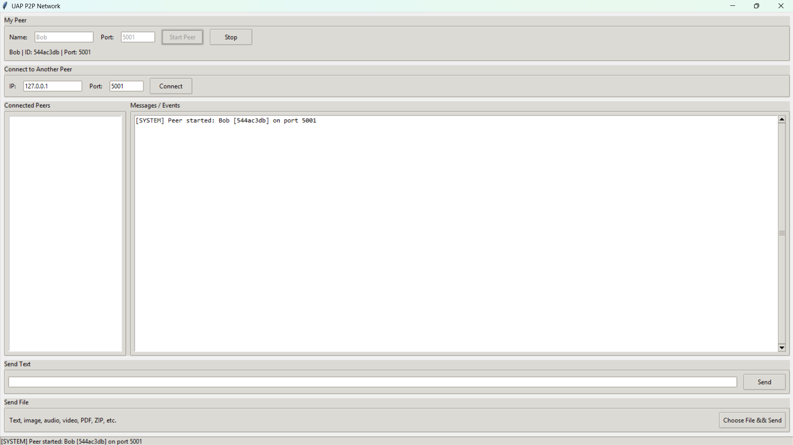
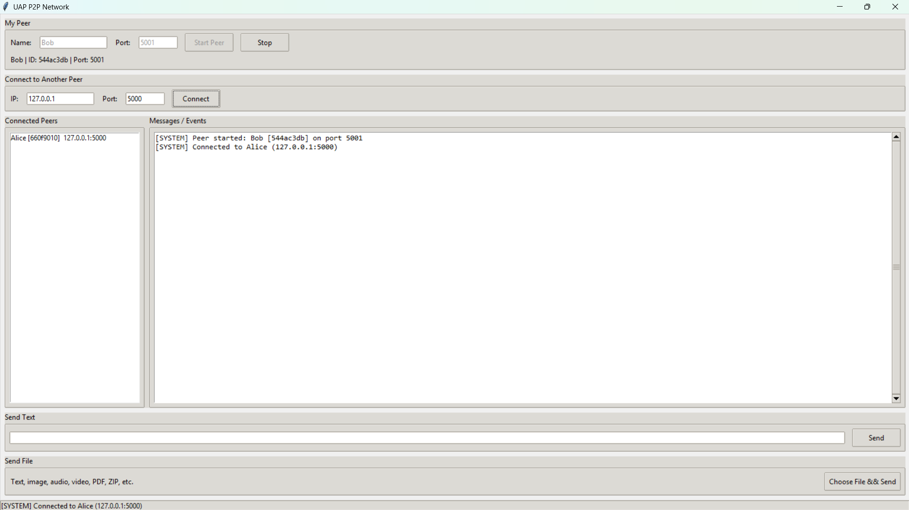
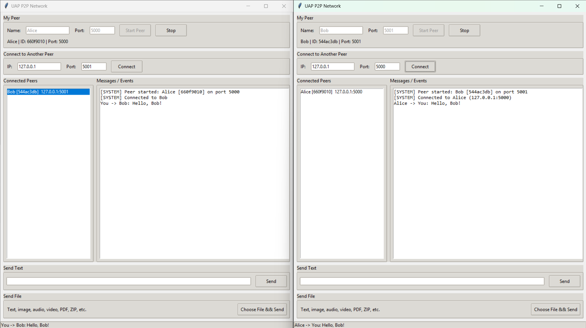
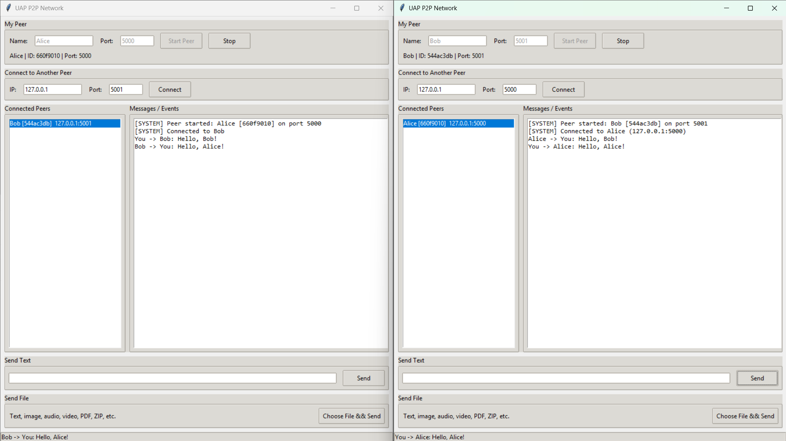
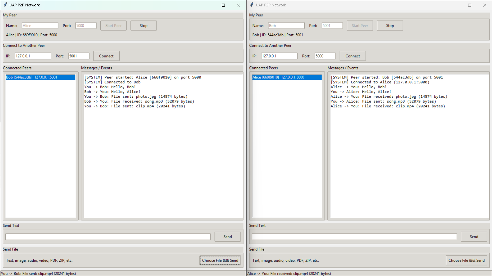
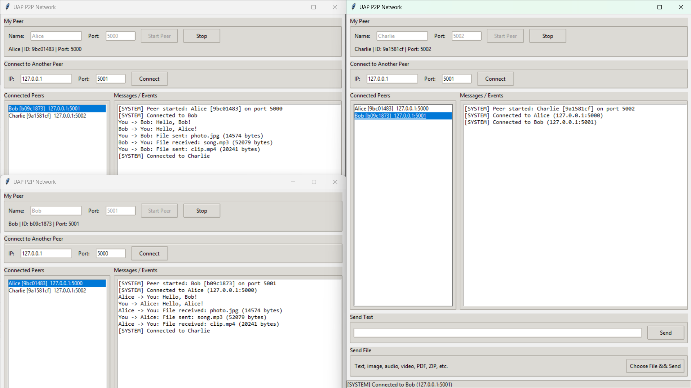
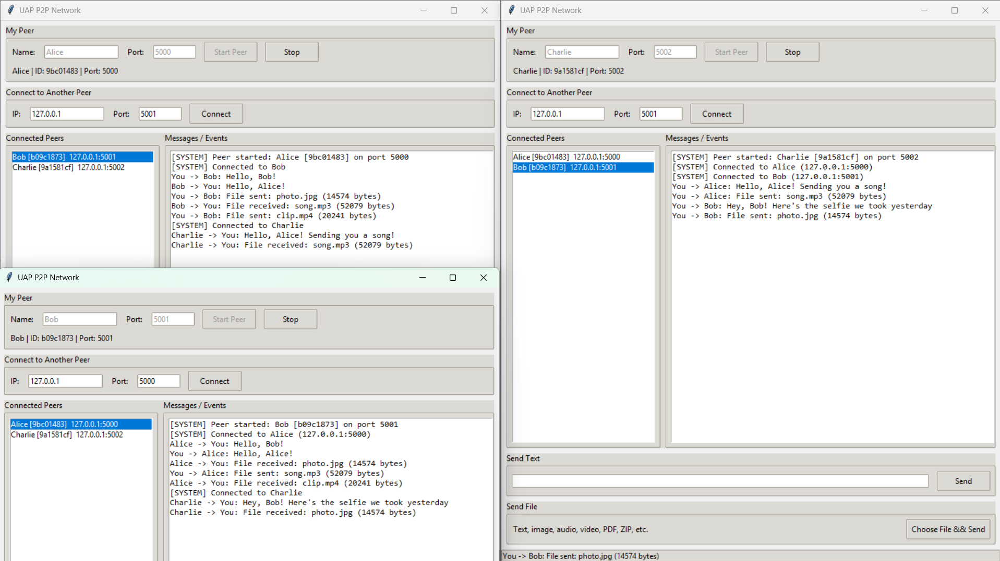

# Peer-to-Peer Network Communication and File Sharing

**Course:** CSE 433 - Blockchain & Distributed Security Lab \
**Department:** Computer Science and Engineering, University of Asia Pacific \
**Submitted By:** Lubaba Hasan - 22201134 - Section AB2 \
**Submitted To:** Nahida Marzan - Lecturer - CSE, UAP

---

## 1. Project Description

This project is a lightweight **peer-to-peer (P2P) network** written in Python. Each running instance of the program is one **peer**. There is no central server: peers connect directly to one another using an IP address and a port number, and then exchange text messages and files over that direct TCP connection.

Every peer plays both roles at the same time:

```
Every peer  =  TCP Server  +  TCP Client
```

* **Server role** - binds a port, listens, and accepts incoming connections.
* **Client role** - connects out to other peers by IP and port.

```
            Peer A
           /      \
      Peer B      Peer C
           \      /
            Peer D
```

---

## 2. Requirements

* Python **3.9 or later**
* No third-party packages - only the standard library
  (`socket`, `threading`, `json`, `struct`, `uuid`, `os`, `queue`, `tkinter`)
* Windows, Linux, or macOS

On Windows and macOS, Tkinter ships with Python. On Debian/Ubuntu:

```bash
sudo apt install python3-tk
```

---

## 3. Project Structure

```
22201134_AB2_P2P_Assignment/
|
|-- main.py            User interface (Tkinter) and user interaction
|-- p2p_node.py        Peer networking: connections, text, file transfer
|-- protocol.py        Encoding/decoding of application-level messages
|-- requirements.txt   Dependency notes (standard library only)
|-- README.md          This file
|
|-- downloads/         Files received from other peers
'-- screenshots/       Screenshots of demonstrations
```

### Responsibilities

| File | Responsibility |
|---|---|
| `main.py` | Builds the window, reads user input, calls into `P2PNode`. Network threads never touch widgets directly - log lines are passed through a `queue` and drained on the GUI thread. |
| `p2p_node.py` | The `P2PNode` class: server socket, accept loop, outgoing connections, one receive thread per peer, text sending, chunked file send/receive, peer bookkeeping, shutdown. |
| `protocol.py` | Message framing (`recv_exactly`, `send_message`, `recv_message`) and builders for the `hello`, `hello_ack`, `text` and `file` messages. |

---

## 4. Setup

No installation step is needed.

```bash
# 1. Unzip
unzip 22201134_AB2_P2P_Assignment.zip
cd 22201134_AB2_P2P_Assignment
```

The `downloads/` folder is created automatically if it is missing.

---

## 5. How to Run

```bash
python main.py
```

---

## 6. How to Connect Two Peers

### Step 1 - Start each peer

In the **My Peer** section, enter a name and a listening port, then press
**Start Peer**.

| | Peer A | Peer B |
|---|---|---|
| Name | `Alice` | `Bob` |
| Port | `5000` | `5001` |

The status line then shows the peer's name, its generated 8-character peer ID,
and its port, for example `Alice | ID: a83f21c4 | Port: 5000`.

### Step 2 - Connect

On **Bob**, in the **Connect to Another Peer** section:

* IP: `127.0.0.1` (same computer) or Alice's LAN IP such as `192.168.1.10`
* Port: `5000`
* Press **Connect**

Both windows now list each other under **Connected Peers**, because the
HELLO handshake exchanged names, IDs and listening ports in both directions.

---

## 7. How to Transfer Files

1. Select the target peer in the **Connected Peers** list.
2. Click **Choose File & Send**.
3. Pick any file - `.txt`, `.jpg`, `.png`, `.mp3`, `.mp4`, `.pdf`, `.zip`, …

Every file is treated as plain binary data, so no separate handling per file type is needed. The receiver writes it into `downloads/`:

```
downloads/
    photo.jpg
    song.mp3
    clip.mp4
```

If a file of the same name already exists, the new one is saved as `photo_1.jpg` rather than overwriting the old one.

---

## 8. Screenshots

All three peers were run on a single computer using the loopback address `127.0.0.1`, with Alice on port 5000, Bob on port 5001, and Charlie on port 5002.

### Demo 1 - Start Peer A

Peer A is started with the name `Alice` and listening port `5000`. The identity line under the input fields shows the name, the generated 8-character peer ID and the port the peer is now listening on.


### Demo 2 - Start Peer B

A second instance of the application is started as `Bob` on port `5001`. A
different port is required because only one listening socket can bind a given
port on the same machine.



### Demo 3 & 4 - Connect Peer B to Peer A, Show the Connected Peer List

Bob connects to `127.0.0.1:5000`. Bob acts as the TCP client here and Alice as
the TCP server, although both peers are capable of either role. Both windows now list each other under **Connected Peers**, with name, peer ID
and address. Alice's list is populated even though Bob initiated the
connection, because the HELLO / HELLO_ACK handshake carries identity
information in both directions.



### Demo 5 - Send a Text Message from A to B

Alice selects Bob in the peer list and sends a text message. The sender logs
`You -> Bob: ...` and the receiver logs `Alice -> You: ...`.



### Demo 6 - Send a Text Message from B to A

Bob replies to Alice over the same TCP connection, confirming that
communication is bidirectional rather than request–response.



### Demo 7, 8 & 9 - Send an Image, Audio, and Video File from A to B

Alice sends an image file to Bob. The file metadata message is sent first,
followed by the raw bytes. Bob writes the result into the `downloads/` folder. Bob then sends an audio file to Alice. Then Alice sends a video file to Bob. The sender streams it in 64 KB chunks rather
than loading it into memory, and the receiver reads exactly the number of bytes
given in the metadata before closing the file.



### Demo 10 - Start Peer C

A third peer, `Charlie`, is started on port `5002` while Alice and Bob remain
connected and running.


### Demo 11 - Connect Peer C to the Network

Charlie connects to Alice on port 5000 and to Bob on port 5001, giving Charlie
two independent connections, each served by its own receive thread. All three
peer lists now show two entries.



### Demo 12 - Communication Involving Peer C

Messages and a file are exchanged between Charlie and the other two peers,
demonstrating that a single peer can maintain and communicate over several
connections at once without any central server.


